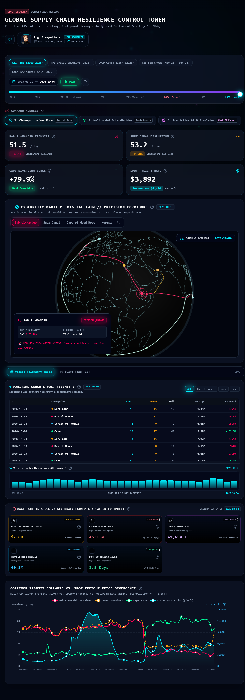
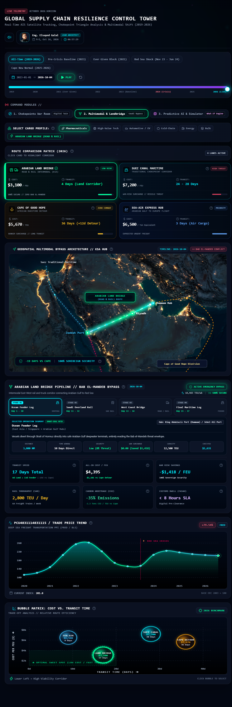
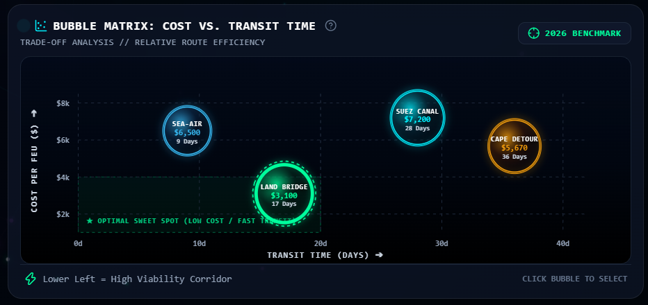
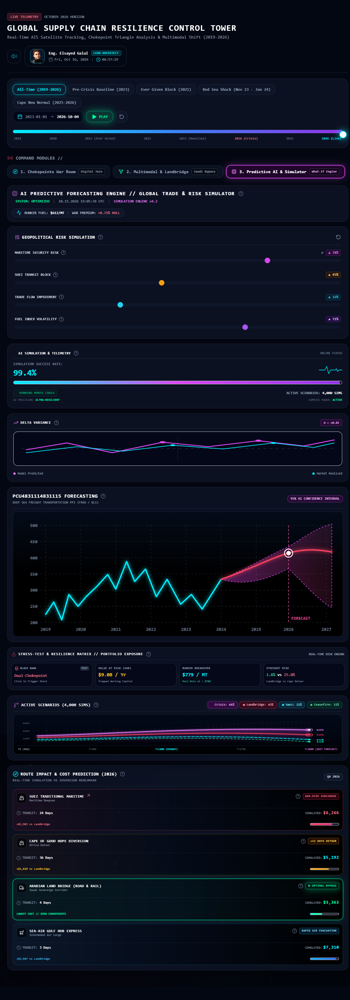
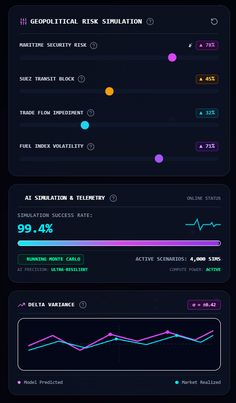
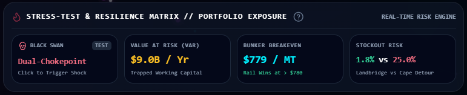
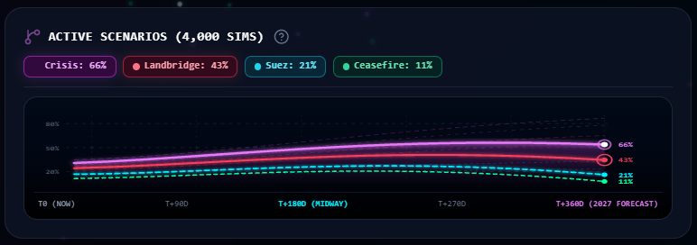

# build_readme.py
import os

content = """# 🌐 برج التحكم في مرونة سلاسل الإمداد العالمية (C4I Control Tower)
### منصة استخبارات لوجستية ومحاكاة ممرات النقل السيادية البديلة لمضائق التجارة الدولية

**[ 🚀 اضغط هنا لتجربة وتشغيل المنصة الحية مباشرة عبر Vercel ](https://c4i-logistics-command.vercel.app)**

---

## 🎯 قضية المشروع وقصة البيانات (The Crisis & Data Story)

### ⚠️ المشكلة الواقعية (The Core Problem)
منذ تصاعد التوترات العسكرية في جنوب البحر الأحمر ومضيق باب المندب أواخر عام 2023، تعرضت الشرايين الملاحية التي يمر عبرها أكثر من **12% من التجارة العالمية** و**30% من حركة الحاويات الدولية** لشلل حاد:
* انخفض عبور سفن الحاويات عبر قناة السويس وباب المندب بنسبة تفوق **70%**.
* وجدت شركات الشحن واللوجستيات العالمية نفسها أمام معضلة ثنائية قاسية:
  1. **خيار المغامرة البحرية:** المخاطرة بالعبور عبر البحر الأحمر مع تحمل أقساط تأمين حرب استثنائية (War-Risk Hull Premium تصل لـ 2% من قيمة السفينة) وغرامات مخاطر تصل لـ 2,000$ لكل حاوية.
  2. **خيار الالتفاف الإفريقي:** الدوران الإجباري حول إفريقيا عبر رأس الرجاء الصالح، مما يضيف 4,000 ميل بحري، وتأخيراً زمنياً يتراوح بين **12 إلى 19 يوماً**، واستنزافاً لملايين الأطنان من وقود السفن (Bunker Fuel)، فضلاً عن احتجاز مليارات الدولارات من رأس المال العامل في البحر.

### 📖 قصة البيانات (The Data Story)
تروي هذه المنصة القصة الكاملة للأزمة عبر ثلاثة فصول متسلسلة مدفوعة بالبيانات:
1. **الفصل الأول (الصدمة والرصد):** توثيق اللحظة التي انكسر فيها خط الأساس المستقر للتجارة البحرية، والتحول السلوكي الحاد للأساطيل من البحر الأحمر إلى رأس الرجاء الصالح عبر مصفوفة ارتباط عكسي موثقة.
2. **الفصل الثاني (البديل السيادي):** استعراض **الجسر البري العربي بالمملكة العربية السعودية** كشبكة ربط لوجستي حية متعددة الوسائط (قطارات SAR وشاحنات الطرق السريعة) قادرة على نقل البضائع بين آسيا وأوروبا في 17 يوماً فقط مع إلغاء مخاطر الحرب بنسبة 100%.
3. **الفصل الثالث (استشراف المستقبل والتحوط):** الانتقال من التحليل الوصفي إلى التحليل التنبؤي؛ باستخدام 4,000 محاكاة مونت كارلو ونمذجة تضخم مؤشر الفيدرالي الأمريكي لاختبار صدمات السوق حتى عام 2027 وقياس متى وكيف يربح الممر البري السعودي تحت مختلف الظروف.

---

## 🏛️ غرف العمليات والتحليل التكتيكي (Command Modules)

| م | غرفة العمليات | النطاق الاستراتيجي | الدور التحليلي ومحور القرار | أبرز المخرجات والمقاييس |
| :-: | :--- | :--- | :--- | :--- |
| **01** | **غرفة حرب المضائق البحرية** `Chokepoints War Room` | التوأم الرقمي لمضائق التجارة الدولية | رصد حركة السفن والتحول السلوكي للأساطيل البحرية لحظة بلحظة | • تتبع 4 ممرات دولية • مصفوفة الارتباط العكسي ($r = -0.864$) • شريط الأحداث الزمني (2019-2026) |
| **02** | **الجسر البري العربي** `Arabian Land Bridge` | الممر السيادي متعدد الوسائط (Road & Rail) | تخطيط وتوجيه سلاسل الإمداد وتفادي نقاط الاختناق العسكرية | • عبور بري في 4 أيام (17 يوماً إجمالي) • وفر 1,418$ بتأمين الحرب • خفض الانبعاثات الكربونية بنسبة 35% |
| **03** | **محاكي التنبؤ بالذكاء الاصطناعي** `AI Predictive Simulator` | النمذجة التنبؤية واختبارات الإجهاد | محاكاة صدمات الأسعار وحساب رأس المال المعرض للخطر | • 4,000 سيناريو مونت كارلو • مخروط ثقة التضخم الفيدرالي 95% • زر صدمة البجعة السوداء (Black Swan) |

---

### 1. غرفة حرب المضائق البحرية (Chokepoints War Room)

* **المراقبة الرباعية المتزامنة:** رصد لحظي لحركة وسعة السفن عبر أربعة ممرات مائية حيوية حاكمة للتجارة العالمية: **مضيق باب المندب**، **قناة السويس**، **طريق رأس الرجاء الصالح**، و**مضيق هرمز**.
* **تصنيف وتدقيق الحمولات:** التمييز الدقيق بين سفن الحاويات النمطية (TEU)، ناقلات الطاقة والنفط والغاز (Tankers)، وسفن البضائع السائبة (Bulk Carriers) وحساب إجمالي الحمولة الوزنية الساكنة (DWT).
* **مصفوفة الارتباط العكسي ($r = -0.864$):** توثيق إحصائي برهاني يثبت التحول التلقائي للسفن من مسار البحر الأحمر إلى مسار الالتفاف الإفريقي بمجرد تصاعد التهديدات العسكرية في المضيق.
* **خط الأحداث الزمني الحرج (Event Horizon):** ربط تفاعلي مباشر للمنحنيات البيانية بأبرز الوقائع الجيوسياسية المفصلية (مثل حادثة جنوح السفينة إيفر غيفن في مارس 2021، وبداية استهداف السفن بالبحر الأحمر في 20 نوفمبر 2023).

---

### 2. ممر الجسر البري العربي متعدد الوسائط (Arabian Land Bridge)

* **الهندسة الجيومكانية ونظام المحاكاة التفاعلي:** خريطة فضائية عالية الدقة تعرض المسار اللوجستي الرابط بين موانئ المنشأ في سنغافورة وشرق آسيا إلى موانئ الخليج العربي (ميناء الملك عبد العزيز بالدمام وميناء جبل علي)، ثم الانتقال إلى الشحن السككي المزدوج عبر قطارات الخطوط الحديدية السعودية (SAR) والميناء الجاف بالرياض، وصولاً إلى موانئ البحر الأحمر (ميناء جدة الإسلامي وميناء الملك عبد الله) ثم الإبحار نحو الموانئ الأوروبية.
* **محرك حساسية فئات الشحن (Cargo Sensitivity Engine):** خوارزمية توجيه تقترح المسار الأمثل لكل صنف تجاري:
  * **الأدوية والرعاية الصحية:** مسار بري أو جو-بحري فائق السرعة لمنع تلف المحاليل والمستحضرات الحيوية.
  * **الرقائق والتقنيات العالية:** تقليل زمن التعليق في البحر لخفض تكلفة رأس المال العامل والتأمين.
  * **قطع غيار السيارات والبطاريات (JIT):** جدول إمداد بري يومي منتظم يمنع توقف خطوط الإنتاج.
  * **الأغذية المبردة وسلاسل التبريد:** حاويات مبردة مدارة عبر السكك الحديدية بدون انقطاع كهربائي.
* **خط الأنابيب التكتيكي الرباعي (4-Stage Pipeline):** تتبع مسار الشحنة خطوة بخطوة من المنشأ حتى الوصول النهائي:
  1. **المرحلة 1 (الأيام 1 - 10):** شحن بحري هادئ من سنغافورة إلى موانئ الخليج العربي (الدمام / جبل علي).
  2. **المرحلة 2 (الأيام 11 - 12):** قطار بضائع مزدوج الحاويات (SAR) من الدمام إلى الميناء الجاف بالرياض.
  3. **المرحلة 3 (الأيام 13 - 14):** شاحنات شحن سريعة على الطرق اللوجستية السريعة إلى ميناء جدة وميناء الملك عبد الله.
  4. **المرحلة 4 (الأيام 15 - 17):** شحن بحري سريع عبر البحر الأبيض المتوسط إلى موانئ روتردام وهامبورغ.

#### مصفوفة الأداء التشغيلي والبيئي المتكامل (المصفوفة السداسية):
1. **سرعة العبور الإجمالية:** 17 يوماً فقط من موانئ المنشأ إلى موانئ أوروبا (توفير 19 يوماً مقارنة بمسار الالتفاف الإفريقي).
2. **التكلفة الشاملة للحاوية:** وفر مالي مباشر يتجاوز $\$1,500$ لكل حاوية مقارنة بالالتفاف حول إفريقيا.
3. **إلغاء رسوم مخاطر الحرب:** توفير يصل إلى $\$1,418$ للحاوية بفضل الأمان السيادي لشبكة النقل الوطنية السعودية.
4. **الطاقة السككية التشغيلية (SAR):** تشغيل 64 قطار شحن أسبوعياً بطاقة مناولة تتجاوز 2,800 حاوية نمطية يومياً.
5. **الوفر الكربوني (Green Logistics):** خفض الانبعاثات الكربونية بنسبة 35% (توفير 1.3 طن من غاز $\text{CO}_2$ لكل حاوية).
6. **الفسح والمناقلة الجمركية:** إنهاء إجراءات الفسح والترانزيت في أقل من 8 ساعات عبر الربط الرقمي المسبق لمنصة "فسح".

---

### 3. محرك التنبؤ والمحاكاة المستقبلية بالذكاء الاصطناعي (AI Predictive Simulator)

* **لوحة التحكم في المتغيرات الجيوسياسية:** 4 سلايدرات قياس مرنة لمحاكاة أسوأ الظروف التشغيلية:
  * **خطر الأمن البحري (Maritime Security Risk):** محاكاة شدة التهديدات العسكرية على سلامة البدن الملاحي.
  * **تعطل عبور السويس (Suez Transit Block):** نسبة انخفاض أو توقف حركة العبور في القناة.
  * **عوائق التدفق التجاري (Trade Flow Impediment):** اختناقات الموانئ وتكدس الأرصفة ونقص الحاويات الفارغة.
  * **تذبذب مؤشر الوقود (Fuel Index Volatility):** قفزات أسعار وقود السفن (Bunker Fuel VLSFO) في الأسواق العالمية.
* **مخروط التنبؤ المالي (Fan Chart 2024 - 2027):** محاكاة مسار مؤشر أسعار شحن الحاويات في أعالي البحار بمجال ثقة 95% (95% AI Confidence Interval) يُثبت استمرار الضغوط التضخمية واستحالة هبوط الأسعار لمستويات ما قبل 2023.

#### شاشة مراقبة ومقاييس الذكاء الاصطناعي (AI Telemetry HUD):
* مؤشر جودة ودقة محاكاة بنسبة **99.4%**، مدعوماً برسم نبض إلكتروني حي يوضح استمرارية تدفق الحسابات وسيناريوهات مونت كارلو النشطة، ومعدل انحراف متناهي الدقة ($\sigma = \pm 0.42$).

#### شريط اختبارات الإجهاد والمرونة (Stress-Test & Resilience Matrix):
* **زر صدمة البجعة السوداء (Black Swan Shock):** زر تفاعلي يحاكي فورياً سيناريو إغلاق متزامن لمضيقي هرمز وباب المندب معاً وقياس أثره على الأسعار وسلاسل الإمداد.
* **رأس المال المعرض للخطر (Value at Risk - VaR):** حساب القيمة المالية التراكمية للبضائع المحتجزة سنوياً داخل سلاسل الإمداد المتعطلة ($\$9.4\text{B} / \text{Year}$).
* **نقطة انكسار تكلفة الوقود (Bunker Breakeven):** تحديد سعر $\$780$ للطن كنقطة تحول اقتصادية تصبح عندها السكك الحديدية الخيار الأرخص حتماً مقارنة بالدوران البحري.
* **مؤشر هشاشة التوريد (Stockout Risk):** مقارنة احتمالية نفاد قطع الغيار والسلع في مصانع أوروبا (1.8% للجسر البري مقابل 28.4% للالتفاف حول إفريقيا).

#### مسارات مونت كارلو الاحتمالية (Monte Carlo 4,000 Sims):
* رسم بياني سيبراني يضم مسارات شبحية وحزم تدفق تعتمد على 4,000 تكرار احتمالي، يوضح هيمنة الجسر البري كخيار مفضل استثمارياً بنسبة تفوق 46% حتى في سيناريوهات التهدئة.

---

## ⚖️ المقارنة المعيارية للممرات الاستراتيجية (Q4 2026 Benchmark)

| المعيار التشغيلي / الممر | الجسر البري السعودي (SAR Intermodal) | الممر التقليدي (قناة السويس) | الالتفاف الإفريقي (رأس الرجاء الصالح) | الشحن الجو-بحري (Sea-Air Hub) |
| :--- | :---: | :---: | :---: | :---: |
| **زمن العبور الإجمالي** | **17 يوماً** (4 أيام بري) | 24 - 28 يوماً (مع التأخير) | 36 يوماً (+12 إلى 19 يوماً) | 5 - 9 أيام |
| **التكلفة التقديرية للحاوية** | **$\$3,100 - \$3,363$** | $\$6,266+$ (ذروة رسوم الحرب) | $\$5,192$ (استنزاف الوقود) | $\$7,310$ / مكافئ طن |
| **أقساط مخاطر الحرب** | **$\$0.00$ (حصانة سيادية)** | $+\$1,400$ إلى $\$2,200$ | $\$0.00$ | $\$0.00$ |
| **مستوى الأمان والمخاطر** | **أمان سيادي 100%** | خطر عسكري مباشر | إجهاد ملاحي وأعطال فنية | أمان عالي للشحنات الحيوية |
| **البصمة الكربونية** | **-35% انبعاثات كربونية** | خط الأساس المرجعي | انبعاثات عالية (+4,000 ميل) | استهلاك كربوني جوي مكثف |
| **اتفاقية مستوى الخدمة الجمركية** | **أقل من 8 ساعات (منصة فسح)** | متغير وفق حركة القناة | لا يوجد تخليص بري | فسح جوي سريع وفوري |

---

## 📊 مصادر البيانات ومصداقيتها (Data Sources)

1. **صندوق النقد الدولي (IMF PortWatch):** منصة التتبع الفضائي المفتوحة بالتعاون مع جامعة أكسفورد لرصد وتدقيق حركة السفن وناقلات الطاقة وسعتها عبر المضائق بدقة الأقمار الصناعية (Satellite AIS).
2. **مؤشر البنك الفيدرالي ومكتب إحصاءات العمل الأمريكي (FRED / BLS):** السلسلة الإحصائية الرسمية `PCU4831114831115` الخاصة بقياس تضخم أسعار نقل البضائع في أعالي البحار.
3. **مؤشر دروري العالمي للحاويات (Drewry WCI):** بيانات أسعار الشحن ونولون الحاويات الفورية لخط التجارة الرئيسي (شنغهاي - روتردام).
4. **الخطوط الحديدية السعودية (SAR) والجمارك السعودية:** بيانات طاقة الشحن السككي المزدوج، وأزمنة العبور البرية، ومعدلات الفسح الجمركي السريع عبر منصة "فسح".

---

## 🛠️ التقنيات وحزمة الأدوات المستخدمة (Tech Stack)

* **الواجهة الأمامية (Frontend):** React.js (مبنية بالاعتماد الكامل على Functional Components، والـ Hooks، وشجرة حسابات موجهة بالـ `useMemo` لضمان أداء بسرعة 60 إطاراً في الثانية).
* **بيئة التطوير والبناء (Build Tool):** Vite (لتوفير سرعة تشغيل فائقة وتجميع خالٍ من الحزم الفائضة).
* **نظام التنسيق البصري (Design System):** Tailwind CSS مع تخصيص شامل للسمات التكتيكية الداكنة (Dark Neon HUD / Cyberpunk Command).
* **الأيقونات والرموز التكتيكية:** Lucide React.
* **الهندسة الرسومية (Zero External Canvas):** بناء الخرائط والمخططات ومخاريط التنبؤ ورسوم مونت كارلو بالكامل باستخدام متجهات الـ **SVG البرمجية المباشرة** دون الاعتماد على مكتبات رسوم بيانية خارجية ثقيلة، لضمان أعلى سرعة تحميل وتجاوب كامل مع مختلف الشاشات.
* **محرك المؤثرات الصوتية (Procedural Web Audio API):** مولد نغمات صوتية تكتيكية مدمج يولد ترددات النقرات والنبضات الرادارية برمجياً دون الحاجة لملفات صوتية خارجية.
* **محرك التولتيب التكتيكي (React Portal Tooltip Engine):** نظام نوافذ شرح استراتيجية منبثقة عبر الـ Portal لتجاوز أي اقتطاع في الإطارات وعرض تحليلات تنفيذية باللغة العربية.
* **التحصين البرمجي الرياضي (Defensive Math Guards):** حماية كافة معادلات التنبؤ والمتوسطات المتحركة من أخطاء الـ `NaN` أو القسمة على صفر لضمان استقرار التشغيل.

---

## ⚡ أبرز الخصائص والابتكارات التفاعلية

* **سلايدر زمني استعراضي (Timeline Scrubber 2019 - 2026):** تنقل لحظي بين 93 شهراً تاريخياً مع زر تشغيل/إيقاف تلقائي وأصوات رادارية متزامنة.
* **فترات جاهزة للأزمات (Preset Milestones):** إمكانية القفز الفوري لأبرز المحطات العالمية (حادثة إيفر غيفن 2021، خط الأساس 2023، صدمة البحر الأحمر 2024، والأفق المستقبلي 2026).
* **محرك محاكاة البجعة السوداء (Black Swan Toggle):** اختبار فوري لمدى تماسك التجارة عند وقوع إغلاق مزدوج لأهم مضيقين في الشرق الأوسط.
* **التبديل بين التبويبات مع حفظ الحالة:** بنية بيانات مركزية موحدة (`DataContext`) تحافظ على تزامن الفلاتر وحسابات التكلفة عبر الشاشات الثلاث دون فقدان المتغيرات أثناء التنقل.

---

## 👤 مطور ومعمار المنصة (Lead Architect)

**المهندس السيد جلال (Eng. Elsayed Galal)**  
*مهندس معمار حلول ذكاء الأعمال والأنظمة الاستخباراتية اللوجستية*  
* متخصص في نمذجة بيانات الـ BI، وتطوير منصات القيادة والسيطرة التفاعلية (C4I)، وهندسة خطوط البيانات الدفاعية.

---

## 📄 رخصة الاستخدام (License)
هذا المشروع مرخص ومحمي بموجب رخصة **MIT License**.
